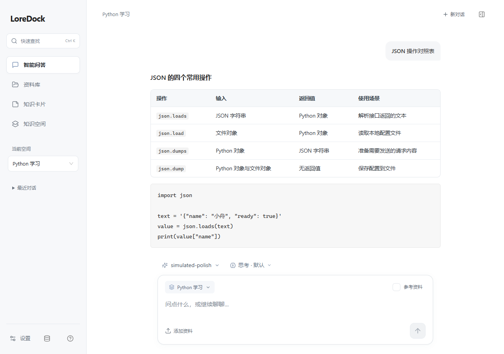
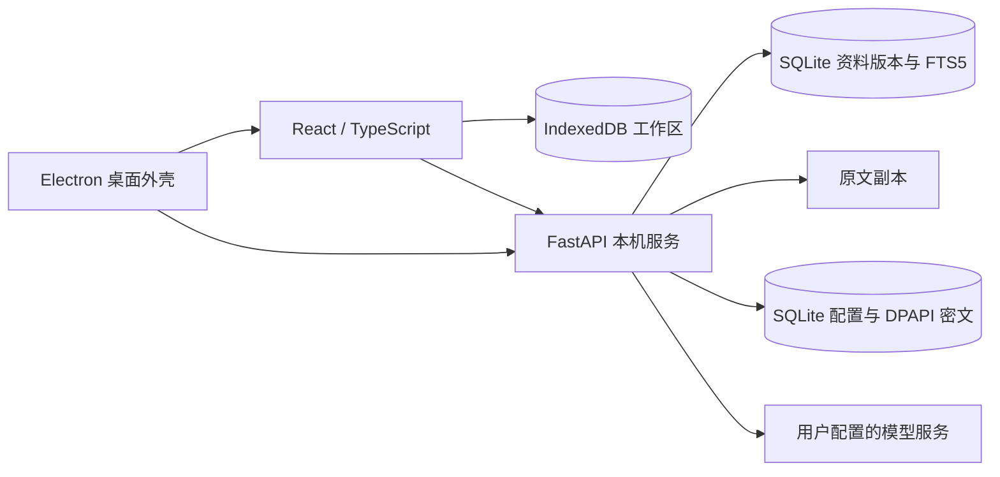
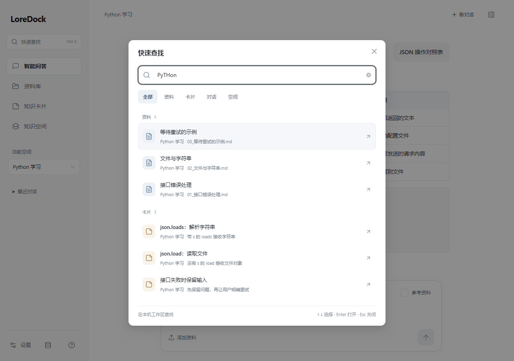

# LoreDock

**面向个人学习与项目资料的本地知识工作台。** 将 Markdown 阅读编辑、资料检索、AI 问答和知识卡片整理放在同一个界面，提供浏览器开发模式和 Windows 桌面版。

[](https://github.com/bpgigi/LoreDock/actions/workflows/ci.yml)

技术栈：React · TypeScript · CodeMirror 6 · FastAPI · SQLite FTS5 · IndexedDB · Electron



截图来自独立示例工作区，回答由模拟服务生成，不包含私人笔记或真实模型凭据。

## 可以做什么

- **组织与查找资料**：按知识空间管理 Markdown / UTF-8 TXT；支持筛选、排序、正文关键词检索，以及 Ctrl / Cmd + K 快速查找资料、卡片、普通对话和空间。
- **阅读与编辑**：Markdown 实时预览、源码、阅读三种视图；支持表格、代码块、目录、自动保存、草稿恢复、版本冲突处理和 Markdown 导出。
- **AI 问答**：配置自己的兼容文本模型服务，选择模型与思考档位；默认普通问答，可按需开启资料参考。阅读选文可附带章节与附近原文，继续追问。
- **来源核对**：开启资料参考时，按空间和资料版本筛选上下文；返回的引用可以打开原文摘录，保留历史版本信息。
- **知识卡片**：手动编辑 Markdown 卡片，或粘贴内容、选取阅读片段、分批处理整篇文章来生成草稿；支持对话修改、合并、来源检查和勾选保存。
- **本机使用**：Windows 桌面版复用同一套前后端；提供工作区 JSON 导入导出，模型密钥使用 Windows DPAPI 加密保存。

相关知识卡片只在回答下方作为本地入口显示，不自动发送给模型。资料参考、选文上下文与卡片生成是各自明确的操作。

## 设计重点

| 问题 | 实现方式 |
| --- | --- |
| 编辑尚未完成时切换页面 | 按文档隔离草稿；等待保存成功后导航，失败保留输入 |
| 并发保存覆盖新内容 | 保存时校验版本；相同正文的版本差异可核对后对齐，真实冲突交由用户处理 |
| 旧请求写入新会话 | 提交时固定上下文快照，以 session_id + request_id 校验返回结果 |
| 检索引用混入其他空间或旧版本 | 后端在同一读取事务中校验空间、资料及版本白名单，引用 ID 仅取自本轮上下文 |
| 删除后的旧副本被重新同步 | 后端持久删除标记与前端专用事务协作，阻止迟到写入复活 |
| AI 草稿重复保存或来源丢失 | 草稿稳定 ID、生成批次回执和 IndexedDB 批量事务；合并时保留来源 |
| 桌面包装与网页功能分叉 | Electron 提供固定应用来源、窗口和后端生命周期，复用 React / FastAPI 实现 |

## 快速开始

完整模型配置与桌面构建以 **Windows 10 / 11、Python 3.12、Node.js 24** 为运行基线。非 Windows 环境不支持密钥持久化。

```powershell
git clone https://github.com/bpgigi/LoreDock.git
cd LoreDock
py -3.12 -m venv .venv
.\.venv\Scripts\python.exe -m pip install -r backend/requirements.txt
npm --prefix frontend ci
```

在两个终端分别启动后端和前端：

```powershell
# 终端 1
.\.venv\Scripts\python.exe -m uvicorn backend.app:app --host 127.0.0.1 --port 8000
```

```powershell
# 终端 2
npm --prefix frontend run dev
```

访问 http://127.0.0.1:5173/ 。完成依赖安装后，也可双击「启动LoreDock.bat」；「停止LoreDock.bat」用于停止该启动器管理的服务。

不配置模型也能体验资料编辑、卡片管理和本机检索。需要 AI 时，进入“设置”添加自定义服务，填写名称、接口公共前缀、API Key 和真实模型 ID。服务应支持 POST /chat/completions；GET /models 可选，不支持时可手动输入模型 ID。

问题、选文及明确开启的资料参考内容会发送至所选服务并使用其额度。仓库不附带 API Key。完整使用步骤见 [使用指南](docs/USER_GUIDE.md)。

## Windows 桌面版

在上面的环境准备完成后：

```powershell
npm --prefix desktop ci
.\.venv\Scripts\python.exe -m pip install -r desktop/requirements-build.txt
npm --prefix desktop run package
```

输出为 release/win-unpacked/LoreDock.exe，运行时需要保留整个 win-unpacked 文件夹。源码仓库不包含已打包程序；打包、数据位置和迁移方法见 [桌面版说明](docs/DESKTOP.md)。

## 架构与数据



| 位置 | 职责 |
| --- | --- |
| frontend/src/components/ | 阅读器、问答、资料库、卡片、模型选择等界面 |
| frontend/src/storage.ts | IndexedDB 专用事务、版本校验和工作区持久化 |
| frontend/src/useDocumentDraft.ts | 编辑缓冲、草稿恢复、异步保存与冲突处理 |
| frontend/src/cardWorkshop.ts | 完整文章分批、草稿状态、修订与来源合并 |
| backend/library.py | 资料版本、分块、FTS5 检索与删除标记 |
| backend/context.py、provider.py | 上下文范围、兼容模型调用与错误处理 |
| backend/card_generation.py | 卡片生成／修订协议及来源校验 |
| desktop/src/ | 应用协议、窗口、权限边界与后端进程管理 |

工作区正文、草稿、会话及卡片存于 IndexedDB；明确同步的资料版本和关键词索引存于后端 SQLite。两者的职责和一致性策略见 [架构说明](docs/ARCHITECTURE.md)，接口与配置见 [后端说明](backend/README.md)。

## 检查

```powershell
npm --prefix frontend run typecheck
npm --prefix frontend test
npm --prefix frontend run build
.\.venv\Scripts\python.exe -m pytest backend/tests -q
npm --prefix desktop test
```

GitHub Actions 在 Windows 上执行类型检查、测试和前端生产构建。模型协议测试使用模拟上游，不消耗真实 API 额度。桌面独立后端测试需要先完成打包，没有构建产物时明确跳过。具体覆盖范围见 [测试说明](docs/TESTING.md)。

## 当前边界

- 当前检索为 **SQLite FTS5 关键词检索**；尚未接入向量库、Embedding 或重排序，不将词法匹配写成语义检索。
- 当前模型协议为文本 Chat Completions，尚未实现流式输出、其他原生协议和图片理解。
- 面向本机单用户使用，没有公网账号系统或多租户授权。
- 工作区 JSON 备份不包含后端数据库、原文副本或密钥；旧资料退索引后，历史原文的物理清理仍待完善。
- 真实服务的生成质量、全部移动端交互与规模性能还需进一步评估。

<details>
<summary>快速查找界面</summary>



</details>